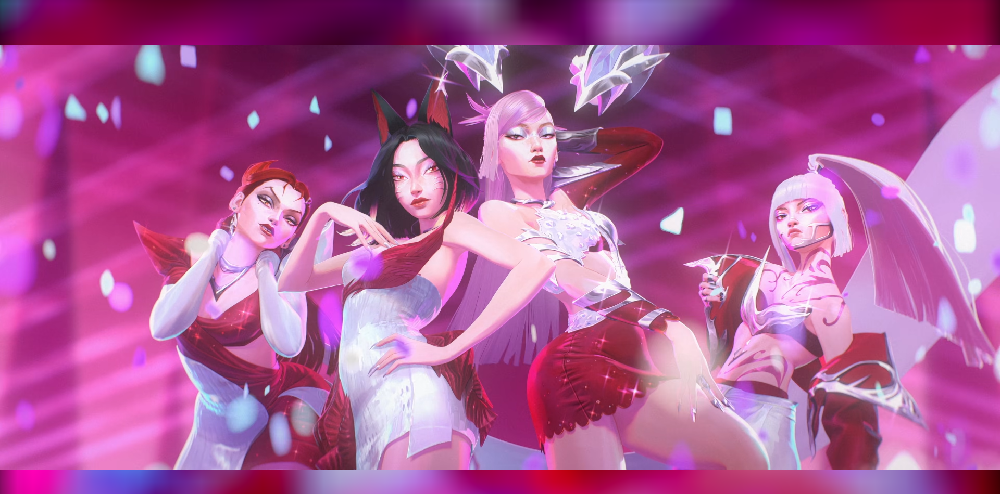

# Fit-Width Background (`thearesia.background`)

A replacement for Omarchy's stock background plugin that renders wallpapers
**edge-to-edge at fit width** and fills any letterbox bars with a blurred,
darkened **ambient layer** of the same image, so non-matching aspect ratios
pick up the wallpaper's mood instead of flat black.

Based on the current stock `omarchy.background` plugin — all stock behavior
(video backgrounds, transition masks, load recovery, theme switch handling)
is preserved on top of upstream.



## Features

- **Fit-width rendering** — wallpapers always span the full screen width;
  vertical overflow is cropped, and any vertical deficit shows the ambient
  bars instead of black.
- **Ambient letterbox** — a heavily blurred, dimmed copy of the wallpaper
  fills the leftover bars (applied to the steady-state image, pre-transition
  and incoming frames).
- Everything from stock: smooth transitions with the reveal mask, video
  backgrounds, prepare/recovery pipeline for theme switches.

## Install

```bash
omarchy plugin add https://github.com/huyhuyhuy8s/ambient-background --enable
omarchy restart shell
```

The stock background service (`omarchy.background`) is disabled for the
session's shell config when this takes its place, the same way
`omarchy plugin clone omarchy.background --edit` sets it up.

## Uninstall

```bash
omarchy plugin disable thearesia.background
omarchy plugin remove thearesia.background --yes
omarchy plugin enable omarchy.background
omarchy restart shell
```

## External dependencies

None beyond Omarchy's own shell (QuickShell / Qt6 with `Qt6::Multimedia` and
qt-multimedia-effects, both already required by the stock desktop).

## License

MIT — see [LICENSE](LICENSE). Derived from
[omarchy.background](https://github.com/basecamp/omarchy/tree/master/usr/share/omarchy/shell/plugins/background)
in [basecamp/omarchy](https://github.com/basecamp/omarchy), MIT licensed.
